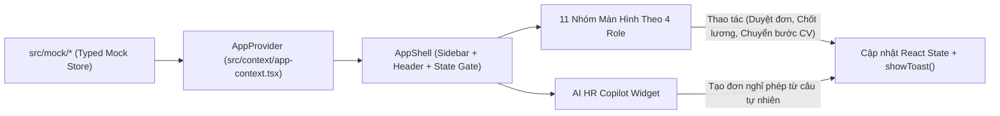

# ARCHITECTURE — Hệ thống Quản trị Hành chính Nhân sự tích hợp AI (AI-Powered HRM)

## 1. TECH STACK (GIAI ĐOẠN 1 — UI PROTOTYPE & MOCK ARCHITECTURE)
- **Framework Frontend:** Next.js 14+ (App Router), React 18, TypeScript (Strict Mode).
- **Styling & Design System:** Tailwind CSS, bộ component nền tảng theo chuẩn `shadcn/ui` tinh chỉnh theo triết lý `/unslop` (Quiet Chrome, 1 neutral ramp `zinc`, 1 accent `teal-700` / `teal-400`, 4px spacing grid).
- **Icons & Biểu đồ:** `lucide-react` (kích thước cố định `16px`, `strokeWidth={1.5}`), `recharts` (biểu đồ phân tích biến động nhân sự và quỹ lương).
- **Quản lý State & Dữ liệu (Giai đoạn 1):**
  - React Context API (`src/context/app-context.tsx`) quản lý Role hiện tại (`RoleCode`), giao diện Sáng/Tối (`theme`), điều hướng đang mở (`activeNav`), trạng thái màn hình (`uiState`: `ready` | `loading` | `empty` | `error`), trạng thái đóng/mở khung AI HR Copilot (`isCopilotOpen`) và hệ thống thông báo (`ToastMessage`).
  - Dữ liệu mẫu định kiểu chặt chẽ tại `src/mock/*`, mô phỏng đầy đủ quan hệ khóa ngoại và nghiệp vụ HRM Việt Nam.
- **Backend / Database / AI API:** **KHÔNG SỬ DỤNG** trong Giai đoạn 1 (Không cài Prisma, không tạo DB, không gọi API ngoài). Kiến trúc dữ liệu trong `src/mock/types.ts` được thiết kế sẵn sàng để ánh xạ 1:1 sang PostgreSQL + REST API ở Giai đoạn 2.

## 2. CẤU TRÚC THƯ MỤC DỰ ÁN
```text
Quan-tri-hanh-chinh-nhan-su/
├── PRD.md                              # Tài liệu đặc tả yêu cầu sản phẩm (11 nhóm màn hình, 5 bước)
├── ARCHITECTURE.md                     # Kiến trúc hệ thống, cấu trúc thư mục & mô hình dữ liệu
├── DESIGN.md                           # Hệ thống thiết kế chuẩn /unslop (Tokens, Typography, Layout)
├── RULES.md                            # Quy tắc cứng cho AI & lập trình viên
├── TASKS.md                            # Kế hoạch thực thi chi tiết 5 bước Deliverables
├── PROGRESS.md                         # Nhật ký tiến độ và trạng thái dự án
├── package.json                        # Khai báo dependencies (Next.js, React, Tailwind, Lucide, Recharts)
├── tsconfig.json                       # Cấu hình TypeScript strict
├── tailwind.config.ts                  # Cấu hình Tailwind CSS (font-sans, font-mono, bảng màu zinc/teal)
└── src/
    ├── app/
    │   ├── globals.css                 # CSS biến môi trường màu sắc, tabular-nums, scrollbar tối giản
    │   ├── layout.tsx                  # Root Layout nạp font Inter & JetBrains Mono + AppProvider
    │   ├── page.tsx                    # Workspace điều phối màn hình theo Role & activeNav
    │   └── login/
    │       └── page.tsx                # Màn hình đăng nhập Split Layout + chọn nhanh 4 Role demo
    ├── components/
    │   ├── ui/                         # Base UI chuẩn shadcn/ui (button, card, badge, input, select, dialog, tabs, skeleton, switch, avatar, tooltip...)
    │   ├── layout/
    │   │   ├── sidebar.tsx             # Sidebar 256px lọc menu động theo 4 Role
    │   │   ├── header.tsx              # Header chứa Role Switcher, UI State Switcher, Theme Toggle
    │   │   └── app-shell.tsx           # Khung bố cục chính xử lý 4 trạng thái (Ready/Loading/Empty/Error)
    │   └── copilot/
    │       └── ai-copilot-widget.tsx   # Trợ lý AI HR Copilot nổi + bóc tách ngôn ngữ tự nhiên tạo đơn phép
    ├── context/
    │   └── app-context.tsx             # State toàn cục (role, theme, activeNav, uiState, toast, copilot)
    ├── lib/
    │   └── utils.ts                    # Hàm tiện ích cn(), formatVND(), formatDateVN()
    └── mock/
        ├── types.ts                    # Toàn bộ TypeScript Interfaces chuẩn hóa như Schema CSDL
        ├── employees.ts                # Dữ liệu nhân sự, phòng ban, hợp đồng, cảnh báo AI Burnout/Turnover
        ├── attendance.ts               # Dữ liệu chấm công tháng, ca làm việc, đơn nghỉ phép & OT, quỹ phép
        ├── payroll.ts                  # Dữ liệu bảng lương Gross -> BHXH/BHYT/BHTN -> Thuế TNCN -> Net
        ├── ats.ts                      # Dữ liệu tin tuyển dụng, ứng viên 5 bước Kanban & AI CV Scoring
        ├── admin.ts                    # Dữ liệu tài khoản, ma trận RBAC, cấu hình hệ thống & Audit Logs
        ├── copilot.ts                  # Kịch bản hội thoại mẫu & parser tạo đơn phép bằng ngôn ngữ tự nhiên
        └── index.ts                    # Điểm xuất (Barrel export) cho toàn bộ dữ liệu mẫu
```

## 3. LUỒNG DỮ LIỆU & TƯƠNG TÁC (CLIENT-SIDE STATE FLOW — GIAI ĐOẠN 1)

1. **Khởi tạo:** Khi ứng dụng tải, `AppProvider` cung cấp trạng thái mặc định (`role = 'HR_MANAGER'`, `theme = 'light'`, `uiState = 'ready'`, `activeNav = 'dashboard'`).
2. **Chuyển đổi Vai trò (Role Switcher):** Khi người dùng đổi Role trên Header (`SUPER_ADMIN` | `HR_MANAGER` | `DEPT_MANAGER` | `EMPLOYEE`), `Sidebar` lập tức lọc lại danh mục menu được phép truy cập, đồng thời màn hình chính hiển thị đúng dữ liệu và quyền thao tác của Role đó.
3. **Kiểm thử 4 Trạng thái UI:** Bộ chọn trạng thái trên Header cho phép chuyển tức thì giữa `Ready` (dữ liệu thật từ `src/mock/`), `Loading` (hiển thị Skeleton khớp kích thước), `Empty` (trạng thái trống có hướng dẫn hành động) và `Error` (thông báo lỗi kèm nút Thử lại).
4. **Tương tác Nghiệp vụ:** Mọi hành động ghi (thêm/cập nhật nhân viên, duyệt/từ chối đơn phép, chuyển cột Kanban ứng viên, cập nhật quyền RBAC, gửi đơn từ AI Copilot) đều cập nhật trực tiếp mảng dữ liệu trong state của component/context và kích hoạt `showToast()` hiển thị thông báo góc dưới phải.

## 4. MÔ HÌNH DỮ LIỆU CỐT LÕI (`src/mock/types.ts`)
Thiết kế chuẩn hóa với tên trường `snake_case` hoặc `camelCase` nhất quán theo đặc tả CSDL thực tế:
- **Tổ chức & Nhân sự (`Department`, `Employee`, `EmploymentContract`, `BurnoutRiskAlert`):**
  - Mã định danh chuẩn (`NV-2024-001`..`NV-2026-015`), phòng ban phân cấp (`parent_id`), chức danh, ngày vào làm, trạng thái (`ACTIVE`, `PROBATION`, `LEAVE`, `RESIGNED`), lương cơ bản VND (`base_salary_vnd`), số người phụ thuộc (`dependents_count`), điểm rủi ro nghỉ việc (`burnout_risk_score` 0-100).
- **Chấm công & Đơn từ (`Shift`, `AttendanceRecord`, `LeaveRequest`, `LeaveBalance`):**
  - Ca làm việc (`HC-08:00`), số công thực tế, số phút đi muộn, số giờ tăng ca (`ot_hours_weekday`, `ot_hours_weekend`, `ot_hours_holiday`), đơn xin nghỉ phép / OT (`PENDING`, `APPROVED`, `REJECTED`).
- **Tính lương (`PayrollPeriod`, `PayrollRecord`):**
  - Lương cơ bản, phụ cấp chịu thuế/miễn thuế, tiền lương OT, tổng thu nhập Gross (`gross_salary_vnd`), khấu trừ BHXH (`8%`), BHYT (`1.5%`), BHTN (`1%`), giảm trừ bản thân (`11.000.000 ₫`), giảm trừ người phụ thuộc (`4.400.000 ₫/người`), thu nhập tính thuế, thuế TNCN (`pit_tax_vnd`), thực lĩnh (`net_salary_vnd`).
- **Tuyển dụng ATS (`JobRequisition`, `CandidateProfile`, `AICvEvaluation`):**
  - Giai đoạn tuyển dụng (`APPLIED` | `AI_SCREENED` | `INTERVIEW` | `OFFER` | `ONBOARDED`), điểm đánh giá AI (`match_score`), danh sách điểm mạnh (`strengths`), thiếu hụt (`gaps`) và câu hỏi phỏng vấn gợi ý (`interview_questions`).
- **Quản trị & Bảo mật (`UserAccount`, `RolePermissionMatrix`, `SystemConfig`, `AuditLogEntry`):**
  - Ma trận quyền theo 4 Role x 6 hành động (`view`, `create`, `edit`, `approve`, `delete`, `export`), tham số bảo hiểm/thuế, và nhật ký hệ thống có địa chỉ IP, timestamp ISO 8601.

## 5. HỢP ĐỒNG CONTEXT (`src/context/app-context.tsx`)
Toàn bộ các component giao diện giao tiếp thông qua hook `useApp()` với hợp đồng kiểu tĩnh:
```typescript
export type RoleCode = 'SUPER_ADMIN' | 'HR_MANAGER' | 'DEPT_MANAGER' | 'EMPLOYEE';

export interface ToastMessage {
  id: string;
  title: string;
  description?: string;
  variant?: 'default' | 'success' | 'warning' | 'error';
}
```
- Các thuộc tính và phương thức bắt buộc trong `useApp()`:
  - `role: RoleCode`, `setRole: (r: RoleCode) => void`
  - `theme: 'light' | 'dark'`, `setTheme: (t: 'light' | 'dark') => void`, `toggleTheme: () => void`
  - `activeNav: string`, `setActiveNav: (id: string) => void`
  - `uiState: 'ready' | 'loading' | 'empty' | 'error'`, `setUiState: (s: 'ready' | 'loading' | 'empty' | 'error') => void`
  - `showToast: (title: string, description?: string, variant?: ToastMessage['variant']) => void`
  - `isCopilotOpen: boolean`, `setIsCopilotOpen: (open: boolean) => void`

## 6. KIẾN TRÚC WEB TĨNH THUẦN (web/)
Giai đoạn 2 đóng băng `src/` (bản tham chiếu Next.js) và triển khai phiên bản web tĩnh thuần (`HTML`, `CSS`, `JavaScript` ES Modules) trong thư mục `web/`.

- **Cấu trúc thư mục `web/`:**
```text
web/
├── index.html                  # Trang Dashboard chính
├── login.html                  # Trang đăng nhập & chọn nhanh 4 Role demo
├── pages/                      # Các trang phân hệ nghiệp vụ
├── partials/                   # Thành phần bố cục dùng chung (sidebar, header, copilot)
├── assets/
│   ├── css/                    # CSS nền (base, theme, layout, common) & tailwind.css build ra
│   ├── js/
│   │   ├── core/               # Tầng Core JS điều phối dùng chung
│   │   ├── components/         # Component JS tái sử dụng
│   │   └── pages/              # Logic từng trang phân hệ
│   └── vendor/                 # Thư viện bên thứ ba đặt local (không dùng CDN ngoài)
└── mock/                       # Dữ liệu JSON tĩnh xuất từ scripts/export-mock-json.mjs
```

- **Tầng Core JS (`web/assets/js/core/`):**
  - `theme-boot.js`: Script non-module nạp sớm ở `<head>` để áp dụng theme Sáng/Tối tức thì, chống chớp Dark mode khi tải trang.
  - `utils.js`: Cung cấp `toUrl()` tính đường dẫn tương đối theo `import.meta.url`, `escapeHtml()` chống XSS khi dùng `innerHTML`, `sanitizeHref()` kiểm tra URL an toàn, cùng các hàm formatters chuẩn `vi-VN`.
  - `api.js`: Nơi duy nhất gọi `fetch()` qua `BASE_URL` để nạp dữ liệu JSON/API.
  - `rbac.js`: Quản lý phân quyền truy cập menu và thao tác theo 4 Role.
  - `state.js`: Quản lý trạng thái toàn cục qua `localStorage` và lưu lịch sử hội thoại AI Copilot qua `sessionStorage` (tối đa 50 tin).
  - `guard.js`: Kiểm tra phiên đăng nhập và quyền truy cập từng trang theo RBAC.
  - `app.js`: Điểm khởi tạo chung cho từng trang (nạp `partials/`, gắn sự kiện header/sidebar, đồng bộ trạng thái).

- **Quy tắc Build CSS & Xuất dữ liệu Mock:**
  - **Tailwind CSS:** Cấu hình riêng tại `tailwind.web.config.mjs`, biên dịch ra `web/assets/css/tailwind.css` qua `npm run css:web` (hoặc theo dõi liên tục `--watch` qua `npm run css:web:watch`).
  - **Mock JSON:** Mở rộng `scripts/export-mock-json.mjs` để xuất dữ liệu từ `src/mock/` sang `web/mock/*.json` qua lệnh `npm run mock:web`.

- **Ngoại lệ giới hạn 500 dòng/file:**
  - Mọi file code viết tay (`HTML`, `CSS`, `JS`) trong `web/` giữ `< 500` dòng.
  - Ngoại lệ không áp dụng giới hạn 500 dòng cho: `web/assets/css/tailwind.css` (file build tự động), `web/mock/*.json` (file JSON sinh tự động) và `web/assets/vendor/` (thư viện ngoài đặt local).
