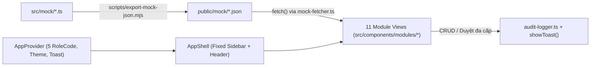

# ARCHITECTURE — Hệ thống Quản trị Hành chính Nhân sự tích hợp AI (AI-Powered HRM)

## 1. TECH STACK (GIAI ĐOẠN 1 — UI PROTOTYPE & MOCK ARCHITECTURE)
- **Framework Frontend:** Next.js 14+ (App Router, cấu hình `output: 'export'` xuất tĩnh ra `out/`), React 18, TypeScript (Strict Mode).
- **Phiên bản Tĩnh Song Song:** Bộ giao diện HTML/CSS/JS thuần tại `web/` phục vụ kiểm thử nhanh không cần build Next.js qua `scripts/serve-web.mjs` (`npm run dev:web`).
- **Styling & Design System:** Tailwind CSS, bộ component nền tảng `shadcn/ui` tinh chỉnh theo triết lý `/unslop` (Quiet Chrome, neutral ramp `zinc`, accent `teal-700`/`teal-400`, 4px spacing grid).
- **Icons & Biểu đồ:** `lucide-react` (`16px`, `strokeWidth={1.5}`), `recharts`.
- **Quản lý State & Dữ liệu:**
  - React Context (`src/context/app-context.tsx`) quản lý 5 vai trò (`RoleCode`), `theme`, `activeNav`, `uiState` (`ready` | `loading` | `empty` | `error`), `currentUserProfile`, `isCopilotOpen` và `ToastMessage`.
  - Dữ liệu gốc định kiểu tại `src/mock/*.ts` -> tự động export ra `public/mock/*.json` qua `scripts/export-mock-json.mjs` (hook `predev`, `prebuild`, `gen:mock`) -> nạp bất đồng bộ qua `fetch()` trong `src/lib/mock-fetcher.ts`.
  - Nhật ký kiểm toán phiên làm việc (`src/lib/audit-logger.ts`) ghi nhận tự động các thao tác CRUD/phê duyệt từ các module nghiệp vụ.
- **Backend / Database / AI API:** **KHÔNG SỬ DỤNG** trong Giai đoạn 1 (Không Prisma, không DB, không API ngoài).

## 2. CẤU TRÚC THƯ MỤC DỰ ÁN
```text
Quan-tri-hanh-chinh-nhan-su/
├── PRD.md                              # Đặc tả yêu cầu sản phẩm (11 nhóm màn hình, 5 bước)
├── ARCHITECTURE.md                     # Kiến trúc kép Next.js + Web tĩnh, cấu trúc thư mục & dữ liệu
├── DESIGN.md                           # Hệ thống thiết kế chuẩn /unslop
├── RULES.md                            # Quy tắc cứng cho AI & lập trình viên
├── TASKS.md                            # Kế hoạch thực thi 5 bước Deliverables
├── PROGRESS.md                         # Nhật ký tiến độ và trạng thái dự án
├── package.json                        # Scripts: gen:mock, mock:web, css:web, dev, dev:web, build, lint, typecheck
├── public/mock/                        # 6 file JSON xuất tự động (admin, ats, attendance, copilot, employees, payroll)
├── scripts/
│   ├── export-mock-json.mjs            # Script export dữ liệu từ src/mock/* ra public/mock/*.json
│   └── serve-web.mjs                   # Server tĩnh phục vụ thư mục web/
├── web/                                # Phiên bản HTML/CSS/JS tĩnh song song (index.html, login.html, pages/, partials/, assets/, mock/)
├── out/                                # Thư mục Static Export của Next.js
└── src/
    ├── app/
    │   ├── globals.css                 # Biến màu sắc, tabular-nums, scrollbar tối giản
    │   ├── layout.tsx                  # Root Layout nạp font Inter & JetBrains Mono + AppProvider
    │   ├── page.tsx                    # Workspace điều phối 11 màn hình theo Role & activeNav
    │   └── login/page.tsx              # Đăng nhập / Đăng ký + 5 pill trải nghiệm nhanh 5 vai trò
    ├── components/
    │   ├── ui/                         # 12 Base UI components (button, card, badge, input, select, dialog, tabs, skeleton, switch, avatar, tooltip, toast-provider)
    │   ├── layout/
    │   │   ├── sidebar.tsx             # Sidebar 256px cố định, lọc menu theo 5 Role, Thẻ tài khoản ở đáy
    │   │   ├── header.tsx              # Header gọn (tiêu đề phân hệ + kỳ dữ liệu, Copilot, Theme Toggle)
    │   │   └── app-shell.tsx           # Khung cố định fixed inset-0 h-dvh overflow-hidden + 4 trạng thái UI
    │   ├── copilot/
    │   │   └── ai-copilot-widget.tsx   # Trợ lý AI HR Copilot nổi + bóc tách ngôn ngữ tự nhiên tạo đơn phép
    │   └── modules/                    # 11 View nghiệp vụ (Dashboard, Core HR, ATS, Attendance, Requests, Payroll, Admin Roles/Settings/Audit, Performance, Payslip)
    ├── context/app-context.tsx         # State toàn cục (5 RoleCode, theme, activeNav, uiState, toast, auth)
    ├── lib/
    │   ├── audit-logger.ts             # Ghi & đọc nhật ký kiểm toán thời gian thực trên state/storage
    │   ├── mock-fetcher.ts             # Nạp dữ liệu từ public/mock/*.json qua fetch()
    │   └── utils.ts                    # cn(), formatVND(), formatDateVN()
    └── mock/                           # 8 module dữ liệu mẫu TypeScript (types, employees, attendance, payroll, ats, admin, copilot, index)
```

## 3. LUỒNG DỮ LIỆU & TƯƠNG TÁC (CLIENT-SIDE FLOW)

1. **Khởi tạo & Nạp dữ liệu:** `predev`/`prebuild` chạy `export-mock-json.mjs` đồng bộ `src/mock/*.ts` sang `public/mock/*.json`. Giao diện nạp dữ liệu qua `mock-fetcher.ts`.
2. **Phân quyền 5 Vai trò:** `Sidebar` lọc danh mục theo `role` (`SUPER_ADMIN` | `DIRECTOR` | `HR_MANAGER` | `DEPT_MANAGER` | `EMPLOYEE`). Việc chuyển role demo thực hiện qua menu `Đổi vai trò (demo)` trong **Thẻ tài khoản** cuối Sidebar (cập nhật đồng bộ `setAuthenticatedUser` với `ROLE_DEFAULT_PROFILES`).
3. **Luồng phê duyệt đa cấp:** `DEPT_MANAGER` (Cấp 1) -> `HR_MANAGER` (Cấp 2, trừ quỹ phép) -> `DIRECTOR` (Cấp 3, khi vượt `director_approval_min_days`, nghỉ không lương hoặc công tác nước ngoài). Từ chối ở bất kỳ cấp nào bắt buộc nhập lý do và dừng đơn ngay.

## 4. MÔ HÌNH DỮ LIỆU CỐT LÕI (`src/mock/types.ts`)
- **Nhân sự (`MOCK_EMPLOYEES` — 28 người):** `employee_code` (`NV-2024-000`..`NV-2026-015`), `role_code` (5 vai trò), `base_salary_vnd` (điều chỉnh giảm 30% sát thực tế), `dependents_count`, `burnout_risk_score`.
- **Đơn từ (`MOCK_LEAVE_OVERTIME_REQUESTS` — 6 đơn):** Bổ sung `approval_steps: ApprovalStep[]` (`role: 'DEPT_MANAGER' | 'HR_MANAGER' | 'DIRECTOR'`), `current_step_role`, `leave_deducted`, `rejection_reason`.
- **Tính lương (`PayrollRecord`):** `gross_salary_vnd` -> `BHXH 8%`, `BHYT 1.5%`, `BHTN 1%` -> Giảm trừ `11.000.000 ₫` + `4.400.000 ₫/người phụ thuộc` -> `Thuế TNCN 7 bậc` -> `net_salary_vnd`.
- **Quản trị (`MOCK_PERMISSION_MATRIX`, `MOCK_AUDIT_LOGS`):** Ma trận 5 vai trò x 6 hành động; Audit Log bất biến có `id`, `timestamp`, `actor_name`, `actor_role`, `action_code`, `target`, `ip_address`, `status`, `detail`.
