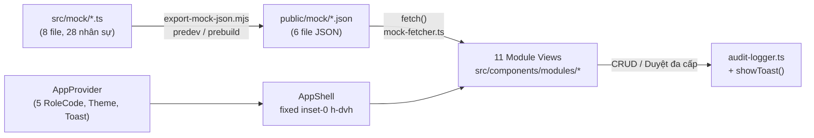

# BÁO CÁO CHI TIẾT DỰ ÁN — AI-Powered HRM

> **Ngày tạo:** 18/11/2026 &nbsp;·&nbsp; **Phiên bản:** v0.1.0 &nbsp;·&nbsp; **Giai đoạn:** 1 — UI Prototype & Mock Architecture

---

## 1. Tổng quan dự án

| Thuộc tính | Giá trị |
|:---|:---|
| **Tên dự án** | Hệ thống Quản trị Hành chính Nhân sự tích hợp AI (AI-Powered HRM) |
| **Package name** | `ai-powered-hrm` v0.1.0 |
| **Framework** | Next.js 14.2.21 (App Router, `output: 'export'`) + HTML/CSS/JS tĩnh (`web/`) |
| **Trạng thái Giai đoạn 1** | ✅ **Hoàn thành 100% — 5/5 bước Deliverables, 11/11 nhóm màn hình** |
| **TypeScript check** | ✅ PASS — `npx tsc --noEmit` → 0 lỗi |
| **Git Repository** | ⚠️ Chưa khởi tạo (không có `.git/`) |

---

## 2. Tech Stack

| Layer | Công nghệ | Phiên bản |
|:---|:---|:---|
| Framework Frontend | Next.js (App Router, `output:'export'`) | 14.2.21 |
| UI Library | React | 18.3.1 |
| Ngôn ngữ | TypeScript (Strict Mode, không dùng `any`) | 5.7.2 |
| Styling | Tailwind CSS | 3.4.17 |
| Component base | shadcn/ui (tinh chỉnh theo triết lý `/unslop`) | custom |
| Icons | lucide-react (`w-4 h-4`, `strokeWidth={1.5}`) | 0.468.0 |
| Biểu đồ | Recharts | 2.15.0 |
| Phiên bản tĩnh | HTML/CSS/JS thuần (`web/`) | — |
| State management | React Context (`AppProvider`) | — |
| Mock data | TypeScript → JSON qua `fetch()` | — |
| Backend / DB / AI API | **KHÔNG SỬ DỤNG** (ngoài phạm vi Giai đoạn 1) | — |

---

## 3. Kiến trúc dữ liệu



### Cấu trúc thư mục cốt lõi

```
Quan-tri-hanh-chinh-nhan-su-main/
├── PRD.md / ARCHITECTURE.md / DESIGN.md / RULES.md / TASKS.md / PROGRESS.md
├── BAO-CAO-DU-AN.md           ← file này
├── package.json
├── src/
│   ├── app/                   # Next.js App Router (login, page, globals.css)
│   ├── components/
│   │   ├── ui/                # 12 Base UI components
│   │   ├── layout/            # AppShell, Sidebar, Header
│   │   ├── copilot/           # AI HR Copilot widget
│   │   └── modules/           # 11 Module views nghiệp vụ
│   ├── context/app-context.tsx
│   ├── lib/                   # audit-logger, mock-fetcher, runtime-store, utils
│   └── mock/                  # 8 file TypeScript dữ liệu mẫu
├── web/                       # Phiên bản HTML/CSS/JS tĩnh song song
├── scripts/                   # export-mock-json.mjs, serve-web.mjs
└── public/mock/               # 6 file JSON xuất tự động
```

---

## 4. Danh sách 11 nhóm màn hình

| # | Nhóm màn hình | Role | Trạng thái |
|:---:|:---|:---|:---:|
| 1 | **Đăng nhập** `/login` + App Shell (Sidebar, Header, Thẻ tài khoản, 5 pill demo) | Tất cả | ✅ |
| 2 | **HR Executive Dashboard** — Thẻ KPI `border-l-4`, biểu đồ Recharts, AI Burnout & Turnover Alert | HR_MANAGER / DIRECTOR | ✅ |
| 3 | **Core HR** — Hồ sơ 360°, Org Chart, Hợp đồng lao động (28 nhân sự) | HR_MANAGER / DIRECTOR | ✅ |
| 4 | **Tuyển dụng ATS** — Kanban 5 bước + AI CV Scoring (`match_score`, `strengths`, `gaps`) | HR_MANAGER | ✅ |
| 5 | **Bảng Chấm Công** tháng — Ma trận ca (`HC-08:00`), OT, đi muộn/về sớm | HR_MANAGER | ✅ |
| 6 | **Phê duyệt Đơn từ Đa cấp** — Stepper 3 cấp, bắt buộc lý do từ chối, tự hủy đơn | Tất cả | ✅ |
| 7 | **Bảng Lương Payroll** (Gross→Net) + Modal Phiếu Lương cá nhân | HR_MANAGER / EMPLOYEE | ✅ |
| 8 | **Quản lý Người dùng & RBAC** — Ma trận 5 vai trò × 6 hành động | SUPER_ADMIN | ✅ |
| 9 | **Cấu hình Hệ thống & Audit Logs** bất biến (chỉ đọc, `border-l-4`) | SUPER_ADMIN | ✅ |
| 10 | **Workspace DEPT_MANAGER** (KPI/OKR, Duyệt cấp 1) + **Cổng ESS EMPLOYEE** | DEPT_MANAGER / EMPLOYEE | ✅ |
| 11 | **AI HR Copilot** — Hỏi đáp quy chế, bóc tách tạo đơn từ ngôn ngữ tự nhiên tiếng Việt | Tất cả | ✅ |

---

## 5. Phân quyền 5 vai trò (RBAC)

| Role | Người dùng | Màu badge | Quyền hạn chính |
|:---|:---|:---|:---|
| `SUPER_ADMIN` | Quản trị IT | Teal | Cấu hình hệ thống, RBAC matrix, Audit Logs — **không** có quyền duyệt điều hành |
| `DIRECTOR` | Giám đốc Điều hành | Violet | Duyệt cấp 3 (nghỉ dài ngày/không lương/công tác nước ngoài), Dashboard điều hành |
| `HR_MANAGER` | Trưởng phòng Nhân sự | Blue | Core HR, ATS, Payroll, Chấm công, Duyệt cấp 2 (trừ quỹ phép) |
| `DEPT_MANAGER` | Trưởng bộ phận | Amber | Duyệt cấp 1 cho quân số phòng, theo dõi KPI/OKR |
| `EMPLOYEE` | Nhân viên | Zinc | ESS: chấm công cá nhân, gửi đơn, xem phiếu lương, dùng AI Copilot |

---

## 6. Luồng phê duyệt đa cấp

```
EMPLOYEE → DEPT_MANAGER (Cấp 1) → HR_MANAGER (Cấp 2 — trừ quỹ phép) → DIRECTOR (Cấp 3) → Hoàn thành
              ↓ Từ chối*                ↓ Từ chối*                           ↓ Từ chối*
           Dừng ngay                 Dừng ngay                            Dừng ngay
```

> [!NOTE]
> `*` Từ chối ở bất kỳ cấp nào đều **bắt buộc nhập lý do** và dừng đơn ngay.
> Ngưỡng kích hoạt duyệt DIRECTOR: `hrm_director_min_days` lưu `localStorage`, cấu hình tại SUPER_ADMIN → Cài đặt hệ thống.

---

## 7. Công thức Payroll chuẩn Việt Nam

```
Gross Salary
  → (−) BHXH:          8%  × Gross
  → (−) BHYT:          1.5% × Gross
  → (−) BHTN:          1%  × Gross
  → (−) Giảm trừ GC:  11.000.000 ₫ (bản thân) + 4.400.000 ₫/người phụ thuộc
  → (−) Thuế TNCN:     Lũy tiến 7 bậc
  ══════════════════════════════════
  → Net Salary  (hiển thị trên Payslip)
```

---

## 8. Dữ liệu mẫu (Mock Data)

| File JSON (`public/mock/`) | Nội dung |
|:---|:---|
| `employees.json` | 28 nhân sự (`NV-2024-000` → `NV-2026-015`), mặt bằng lương giảm 30% thực tế VN |
| `attendance.json` | Bảng chấm công tháng theo ca (`HC-08:00`, `CA-SANG`, `CA-CHIEU`) |
| `payroll.json` | Bảng lương Gross→Net đầy đủ 7 bậc thuế TNCN |
| `ats.json` | Hồ sơ ứng viên Kanban 5 bước + AI CV Scoring |
| `admin.json` | RBAC matrix, cấu hình hệ thống, Audit Logs mẫu |
| `copilot.json` | Kịch bản hỏi đáp AI HR Copilot, tạo đơn từ ngôn ngữ tự nhiên |

**Quy trình đồng bộ:** `src/mock/*.ts` → `npm run gen:mock` → `public/mock/*.json` → `fetch()` qua `src/lib/mock-fetcher.ts`

---

## 9. Design System (/Unslop)

| Quy tắc | Giá trị |
|:---|:---|
| Màu trung tính | `zinc` (nền, viền, chữ toàn bộ) |
| Màu nhấn duy nhất | `teal-700` (Light) / `teal-400` (Dark) |
| Font UI | Inter (400 / 500 / 600) — cấm bold 700+ |
| Font code / số | JetBrains Mono + `tabular-nums` (mã NV, tiền VND, IP, ca) |
| Icon | lucide-react `w-4 h-4` `strokeWidth={1.5}` |
| Thẻ KPI | `border-l-4` + nền tint ngữ nghĩa (kèm `dark:` variant) |
| Motion | Chỉ `transition-colors duration-150 ease-out` |
| **CẤM tuyệt đối** | Emoji · Gradient đa sắc · Glow · `uppercase tracking-widest` · `transition-all` · dấu `!` |

---

## 10. Lệnh vận hành

```bash
npm run gen:mock       # Export src/mock/*.ts → public/mock/*.json
npm run dev            # Chạy Next.js dev server (localhost:3000)
npm run dev:web        # Chạy phiên bản HTML tĩnh web/
npm run build          # Build static export ra out/
npm run typecheck      # Kiểm tra TypeScript (phải 0 lỗi)
npm run lint           # ESLint
npm run css:web        # Build Tailwind CSS cho web/
```

---

## 11. Tiến độ 5 bước Deliverables

| Bước | Nội dung | Trạng thái |
|:---:|:---|:---:|
| 1 | Khung Next.js, bộ 6 file Vibe Coding, Mock Data (`src/mock/`), App Shell, Login, AI Copilot | ✅ |
| 2 | Phân hệ HR_MANAGER / DIRECTOR — Dashboard, Core HR (28 NV), ATS Kanban + AI CV Scoring | ✅ |
| 3 | Chấm công tháng, Phê duyệt đơn từ đa cấp, Payroll Gross→Net + Phiếu Lương | ✅ |
| 4 | Phân hệ SUPER_ADMIN — Quản lý người dùng, RBAC 5×6, Cấu hình hệ thống, Audit Logs bất biến | ✅ |
| 5 | Workspace DEPT_MANAGER, Cổng ESS EMPLOYEE, AI HR Copilot, bản tĩnh `web/`, nghiệm thu | ✅ |

---

## 12. Những gì còn thiếu — Gợi ý bổ sung

> [!CAUTION]
> **P1 — Khẩn, cần làm ngay**

### 12.1 Git Repository
- **Vấn đề:** Dự án **chưa có `.git/`** — không có lịch sử commit, không rollback được.
- **Rủi ro:** Mất toàn bộ code nếu có sự cố máy chủ hoặc ghi đè nhầm.
- **Cách fix:**
  ```bash
  git init
  git add .
  git commit -m "feat: Giai doan 1 hoan thanh - 11 man hinh, 5 buoc deliverables"
  # Push lên GitHub/GitLab
  ```

### 12.2 Kiểm thử (Testing)
- **Vấn đề:** Không có unit test, integration test hay E2E test nào.
- **Rủi ro:** Công thức Payroll (BHXH/TNCN) và luồng duyệt đa cấp không có lưới bảo vệ.
- **Đề xuất:**
  - `Vitest` cho unit test logic nghiệp vụ (công thức lương, bóc tách AI Copilot)
  - `Playwright` cho E2E (đăng nhập, duyệt đơn, xem phiếu lương)

### 12.3 CI/CD Pipeline
- **Vấn đề:** Không có `.github/workflows/` hay pipeline tự động nào.
- **Đề xuất:** GitHub Actions chạy `typecheck + lint + build` trên mỗi PR.

> [!WARNING]
> **P2 — Nên bổ sung để hoàn thiện**

### 12.4 README.md
- Cần bổ sung: hướng dẫn cài đặt, cấu trúc thư mục, danh sách 5 Role demo, ảnh chụp màn hình, lệnh chạy dev.

### 12.5 Phiên bản `web/` còn thiếu trang nghiệp vụ
- Hiện `web/` chỉ có `index.html` và `login.html`. Nếu mục tiêu demo không cần Node.js cần dựng thêm 11 trang HTML.

### 12.6 Responsive Mobile
- PRD yêu cầu responsive từ `360px` → `1600px`. App Shell dùng `fixed inset-0` cần kiểm thử thực tế trên thiết bị di động.

### 12.7 Lighthouse & Accessibility
- Chưa có kết quả Lighthouse (Performance, a11y, Best Practices, SEO).
- Chưa kiểm tra WCAG 2.1 AA: keyboard navigation, ARIA labels, color contrast.

> [!NOTE]
> **P3 — Chuẩn bị cho Giai đoạn 2**

### 12.8 `.env.example`
- Tạo file template chuẩn bị cho Giai đoạn 2 (DB connection string, Gemini API key, NextAuth secret).

### 12.9 Kế hoạch Giai đoạn 2
- Lập PRD + TASKS cho Giai đoạn 2: **Next.js Route Handlers / NestJS** + **PostgreSQL + Prisma** + **NextAuth.js** + **Gemini / OpenAI API** thật.

---

## 13. Ma trận độ ưu tiên bổ sung

| Hạng mục thiếu | Độ ưu tiên | Effort | Tác động |
|:---|:---:|:---:|:---|
| Git Repository | 🔴 P1 | Thấp (5 phút) | Bảo toàn toàn bộ công sức |
| Unit Test (công thức Payroll) | 🔴 P1 | Trung bình | Đảm bảo công thức lương đúng |
| E2E Test (luồng duyệt đa cấp) | 🔴 P1 | Cao | Phát hiện regression sớm |
| CI/CD GitHub Actions | 🔴 P1 | Thấp | Gate chất lượng tự động |
| README.md đầy đủ | 🟡 P2 | Thấp | Onboarding thành viên mới |
| Phiên bản `web/` đầy đủ | 🟡 P2 | Cao | Demo không cần Node.js |
| Lighthouse & a11y audit | 🟡 P2 | Thấp | Baseline metrics & WCAG |
| `.env.example` | 🟢 P3 | Thấp | Chuẩn bị Giai đoạn 2 |
| Kế hoạch Giai đoạn 2 | 🟢 P3 | Trung bình | Roadmap rõ ràng cho team |

---

## 14. Điểm mạnh & Điểm cần cải thiện

### Điểm mạnh

- Tài liệu hoàn chỉnh — bộ 6 file Vibe Coding đồng bộ (`PRD`, `ARCHITECTURE`, `DESIGN`, `RULES`, `TASKS`, `PROGRESS`)
- 11 module nghiệp vụ hoàn chỉnh, TypeScript Strict — 0 lỗi biên dịch
- Design System nhất quán `/unslop` — không "AI slop", không emoji, không gradient lòe loẹt
- Luồng phê duyệt 3 cấp chuẩn nghiệp vụ Việt Nam, Audit Log bất biến
- Công thức Payroll chuẩn luật lao động VN (BHXH/BHYT/BHTN/TNCN 7 bậc)
- Kiến trúc kép (Next.js + HTML tĩnh) linh hoạt cho nhiều môi trường demo
- AI HR Copilot bóc tách tiếng Việt tạo đơn từ ngôn ngữ tự nhiên

### Điểm cần cải thiện

- Chưa có Git repository — rủi ro mất code toàn bộ (**cần làm ngay**)
- Zero test coverage — không có safety net cho công thức lương và luồng duyệt
- Không có CI/CD pipeline tự động
- Phiên bản `web/` còn thiếu nhiều trang nghiệp vụ
- `README.md` chưa đầy đủ cho người mới
- Chưa đánh giá Accessibility (WCAG 2.1 AA) và Lighthouse performance

---

*Báo cáo tổng hợp từ: `PRD.md` · `ARCHITECTURE.md` · `DESIGN.md` · `RULES.md` · `TASKS.md` · `PROGRESS.md` · `.agents/memory/MEMORY.md` · `package.json` và cấu trúc thư mục thực tế.*
